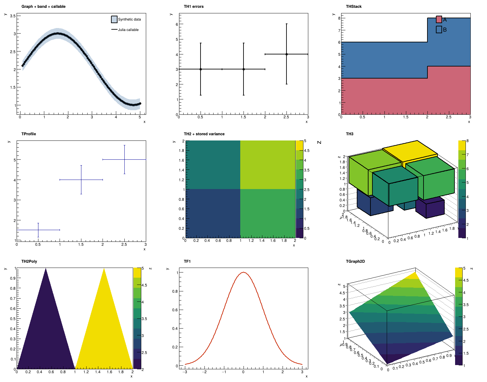

# ROOTPlots.jl

**Julian plotting and fitting with native CERN ROOT.**

Create scientific plots and perform ROOT fits from Julia. Numerical inputs and
plot specifications are Julia values; a small C++ bridge runs ROOT in isolated
batch processes and writes PNG/PDF. No Julia plotting package, Python, PyCall, or
GUI is required. ROOT itself must be installed separately.

**Status:** experimental (0.2.2). Source on GitHub; not registered in the Julia
General registry. The former package name was `JuliaROOT`. See [migration](docs/migration.md).



*Native ROOT output from `scripts/graphics_gallery.jl`; synthetic inputs only.*

## Design

ROOTPlots.jl is a Julia API for using ROOT's own drawing and fitting features,
not a reimplementation. Every option maps onto a ROOT method/option/style
setting, named so a ROOT user recognises it (snake_case of the ROOT method;
docstring cites it). An unset option keeps ROOT's default behaviour. Drawing,
statistics, fitting and formatting are done by ROOT; Julia only validates input
and passes data/options. See [design](docs/design.md).

## Requirements and installation

- Julia **1.11+**.
- CERN ROOT **6.40+**, including `root-config`, headers and libraries.
- A ROOT-compatible C++ compiler; `c++` by default, or the executable set in `CXX`.
- macOS/Linux are the development targets. Windows is not validated.

Install from GitHub into your Julia environment (recommended):

```julia
using Pkg
Pkg.add(url="https://github.com/Kim-WooJong/ROOTPlots.jl")
using ROOTPlots
build_root()   # optional: compile the native bridges now (otherwise on first use)
```

ROOTPlots is **not registered in General**, so `Pkg.add("ROOTPlots")` does not
work; use the URL form above. Pass `rev=` with a release tag or commit hash to pin
a version.

For development, work from a source checkout instead:

```sh
git clone https://github.com/Kim-WooJong/ROOTPlots.jl
cd ROOTPlots.jl
julia --project=. -e 'using Pkg; Pkg.instantiate()'
julia --project=. scripts/doctor.jl
```

and use `Pkg.develop(path="/absolute/path/to/ROOTPlots.jl")` from a separate
analysis environment. Detailed setup, cache behavior, and server
troubleshooting: [installation](docs/installation.md).

### ROOT messages

ROOT's informational messages (for example `Info in <TCanvas::Print>: png file
... has been created` for every saved file) are suppressed by default: the
native processes set ROOT's message level to *warning*, so ROOT warnings and
errors are still printed. Set `ROOTPLOTS_ROOT_VERBOSE=1` to restore ROOT's
default verbosity, e.g. `withenv("ROOTPLOTS_ROOT_VERBOSE" => "1") do render_root(...) end`.

## Quick start

```julia
using ROOTPlots

h = histogram([.2, .4, 1.2, 1.7], [0., 1., 2.]).hist
files = render_root(h, GraphSpec(xlabel="x", ylabel="Counts"),
                    "output/histogram"; draw=:e1, format=:both)
@show files.png files.pdf

observed = GraphSeries([0., 1., 2., 3.], [1.1, 2.9, 5.2, 6.8];
                       yerrors=fill(.2, 4), label="Synthetic data")
fit = fit_root(observed, :pol1; initial=[0., 1.])
fit.status == 0 && fit.valid || error("Fit did not converge")
render_root([fit_curve(fit), observed], GraphSpec(xlabel="x", ylabel="Response"),
            "output/fit"; format=:both)
```

`format=:png` is the default. `:pdf` and `:both` are also supported; unselected
return paths are `nothing`. All example data are **synthetic, not measurements**.

ROOT's own statistics and fit boxes are opt-in keywords:

```julia
gfit = fit_root(h, :pol0; initial=[2.])
render_root(h, GraphSpec(), "output/stats"; draw=:e1, stats=true,   # name, Entries, Mean, Std Dev
            attached_fit=gfit, fitstats=true)                       # χ²/ndf, Prob, p0 ± error
```

See [statistics and fit boxes](docs/api.md#statistics-and-fit-boxes) for field
selection (`stats=(:entries, :mean, :underflow, :overflow)` or ROOT's `"nemruo"`),
placement, 2D/3D histograms, profiles, graphs, and figures.

Experiment styles are one keyword: `style` selects a ROOT `TStyle`
(`gROOT->SetStyle`), e.g. ROOT's built-in `:ATLAS`, or the package's `:CMS` style,
which also draws the "CMS Preliminary" label:

```julia
render_root(h, GraphSpec(xlabel="m [GeV]", ylabel="Events", style=:CMS), "output/cms"; draw=:e1)
render_root(h, GraphSpec(style=:CMS, cms_label=(extra="Simulation", energy="13 TeV")), "output/sim")
render_root(h, GraphSpec(style=:ATLAS, atlas_label=(text="Internal", energy="13 TeV",
                                                   lumi="140 fb^{-1}")), "output/atlas")
```

The CMS and ATLAS labels are for collaboration use under each collaboration's
publication rules; the package only provides the styling. See
[experiment styles](docs/api.md#experiment-styles).

## Scope

| Task | Main API |
| --- | --- |
| Weighted 1D/2D/3D histograms, flows, projection | `histogram`, `Hist1D/2D/3D`, `projection` |
| Points, curves, asymmetric errors and bands | `GraphSeries`, `GraphSpec`, `GraphStyle` |
| Bent error bars; several y-error sets (stat/syst) | `BentErrorSeries`, `MultiErrorSeries`, `YErrorSet` |
| Heatmaps, contours, surfaces, XYZ/error graphs | `Grid2D/3D`, `Graph3D`, `Graph3DErrors` |
| Stacks, profiles, (non-convex) polygon bins | `HistStack`, `Profile1D/2D/3D`, `PolygonHist2D` |
| ROOT fits, covariance and residual diagnostics | `fit_root`, `FitResult`, `chi2_pvalue` |
| ROOT statistics and fit boxes (Entries, Mean, χ²/ndf, parameters) | `stats`, `fitstats`, `attached_fit` keywords |
| Native TF1, spline, QQ, polar, efficiency, pie | `ModelCurve`, `SplineCurve`, `QQGraph`, etc. |
| Native TF2/TF3 from predefined formulas; sampled Julia grids | `ModelSurface`, `ModelVolume`, `function_grid` |
| Mixed and nested panels, annotations, polygons, axes, legends | `PlotFigure`, `PlotPanel`, `PlotPolygon`, `AxisStyle`, `PlotText` |
| ROOT axis formats (log, no exponent, more log labels, bin/time labels, `ChangeLabel`), grids, ROOT title box | `AxisStyle`, `LabelChange`, `CanvasStyle` |
| ROOT styles (`gROOT->SetStyle`: ATLAS, Plain, ...; CMS publication style) and CMS/ATLAS labels | `style`, `cms_label`, `atlas_label`, `root_styles` |
| Data/model comparisons with ratio panels | `comparison`, `Component`, `PanelSpec` |
| Bounded parallel independent ROOT jobs | `rootmap` |

Not a complete ROOT binding. No ROOT-file I/O, RDataFrame, GUI/OpenGL, RooFit,
RooStats, or arbitrary C++/TF1/TF2/TF3-expression evaluation: analytic functions
come from a fixed list of named formulas, and other Julia functions are sampled.
TF3 offers only batch-renderable (non-OpenGL) views; polygons with holes are not
supported. Use tools such as UnROOT for input files. See the
[API and scientific semantics](docs/api.md) for supported options and limits.

## Dependencies

**CSV.jl and DataFrames.jl are included** for convenient input and analysis.
Use vectors directly or `histogram(df, :x, edges; weight=:w)` and the 2D/3D column
adapters. No extension setup or separate examples environment is needed.

SpecialFunctions.jl supplies error/incomplete-gamma functions; Scratch.jl
manages a writable native build cache outside the package source. SHA and
Printf/Statistics are standard-library dependencies. No Makie, CairoMakie, or Plots
dependency is present, even optionally.

## Examples

Examples (native ROOT required):

```sh
julia --project=. scripts/demo.jl
julia --project=. scripts/graphfit_demo.jl
julia --threads=4 --project=. scripts/graphics_gallery.jl
julia --project=. scripts/special_graph_demo.jl
julia --project=. scripts/graph_extension_demo.jl
julia --project=. scripts/edge_profile_demo.jl
julia --project=. scripts/stats_box_demo.jl
julia --project=. scripts/axis_format_demo.jl
julia --project=. scripts/experiment_style_demo.jl
```

Outputs go to `examples/output/`. CSV/DataFrames analysis examples use the same
project environment:

```sh
julia --project=. scripts/histogram_fit_demo.jl
```

## Validation

```sh
# Fails if a Julia plotting package is in the dependency graph; checks CSV/table input.
julia --project=. test/dependency_smoke.jl
# Julia numerical/input tests; native ROOT sections are explicitly skipped.
ROOTPLOTS_TEST_ROOT=off julia --threads=4 --project=. -e 'using Pkg; Pkg.test()'
# Full integration: fails, rather than silently skips, if ROOT is absent.
ROOTPLOTS_TEST_ROOT=required julia --threads=4 --project=. -e 'using Pkg; Pkg.test()'
# Visual regression against reference PNGs (see docs/testing.md).
ROOTPLOTS_VISUAL=required julia --project=. -e 'using Pkg; Pkg.test()'
```

Tests cover numerical results, invalid inputs, native output, concurrent
builds/jobs, and pixel comparison of representative figures against reference
PNGs. Pixel references are only comparable in the environment that produced them,
and passing tests are not proof of scientific equivalence. See
[testing](docs/testing.md) for modes and validated environments.
The included GitHub Actions workflow runs the rootless tests (Julia 1.11 and
current) and the native ROOT suite (Linux, conda-forge ROOT) on GitHub-hosted
runners; see [testing](docs/testing.md).

## License

[MIT](LICENSE) for the original package code. ROOT and other external
dependencies retain their own licenses; see [third-party notes](THIRD_PARTY.md).
